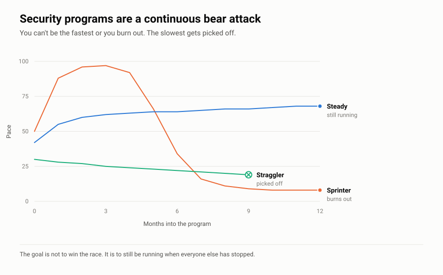

# Harrison Ward

**Security Shouldn't Be Paywalled.**

Most of what a company needs to be safer isn't secret and isn't hard. It's just locked up behind a consulting engagement or a form that wants your email before it'll show you a checklist.

So I'm putting the stuff I'd hand a client on day one out here. Free. No form. Licensed so you can use it commercially.

---

I'm a cyber risk and technology exec. 30 years across financial services, professional services, and critical infrastructure. Ran technology as CTO for a five-office firm. Most recently SVP in Kroll's Cyber Risk practice, sitting as vCISO for enterprise clients.

I work on the boring half of security. The policies, the controls, the habits. The stuff that turns a strategy deck into something somebody actually does on a Tuesday.

Right now a lot of that is AI. How do you govern GenAI and agents without banning them outright or letting them run loose? Most frameworks haven't caught up yet.

---

## Security Programs Are a Continuous Bear Attack

<picture>
  <source media="(prefers-color-scheme: dark)" srcset="charts/bear-attack-dark.svg">
  
</picture>

You don't have to outrun the bear. You have to not be the slowest.

But you can't sprint either. Go all out and you burn your team down in two quarters, and the program dies with your enthusiasm. The job is finding a pace you can hold for years.

That's one of eleven things I say a lot. The rest are in **[PRINCIPLES.md](https://github.com/HarrisonWard/.github/blob/main/PRINCIPLES.md)**. Everything here comes out of them.

---

## What I Work On

- **Cyber Risk and Governance.** Building programs, running maturity assessments, reporting to boards. NIST CSF, ISO 27001, CIS, CMMC, HIPAA, PCI, NIST 800-82.
- **VCISO Work.** Owning cyber strategy and the risk roadmap for enterprise clients, including regulated and critical infrastructure.
- **AI Governance.** Acceptable use, controls, oversight for GenAI and agentic systems. New risk model. Most frameworks are behind.
- **Third-party Risk.** TPRM and supply chain. Vendor tiering through remediation.
- **Incident Readiness.** 50 plus tabletops and IR readiness engagements.
- **Enterprise Tech.** Took a 175-person firm from all on-prem to cloud-first. Paid off in March 2020 when everyone went home overnight and nothing broke.

---

## Where I've Been

| | |
|---|---|
| **Harrison Ward Technology** | Owner, security-first managed services for North Texas small businesses |
| **Kroll** | SVP, Cyber Risk Advisory Services |
| **Roberts Markel Weinberg Butler Hailey PC** | Chief Technology Officer |
| **Alvarez & Marsal** | Manager, Forensic Technology Services |
| **Ernst & Young** | Senior, Fraud Investigation & Dispute Services |

B.B.A. Management Information Systems, Texas Tech
EnCE · RCA · Cellebrite CCLO and CCPA

---

## What's Here

**[Security Lessons](https://github.com/HarrisonWard/security-lessons)** is the big one. 727 security lessons from stories people already know. The Simpsons, Shakespeare, Star Wars, the KJV Bible, Breaking Bad, real heists, Greek myth, a century of actual incidents. Every one mapped to NIST CSF 2.0 and ISO 27001.

I talk in analogies because framework language doesn't move anybody. That repo is 727 of them.

The rest, grouped by the job you're trying to do:

**Build the Program**
- **[Security Program Starter](https://github.com/HarrisonWard/Security-Program-Starter).** Twenty-two readable policies for a company that has none. Mapped to CIS Controls v8.
- **[Least Privilege and RBAC](https://github.com/HarrisonWard/Least-Privilege-and-RBAC).** Access that maps to real jobs, and reviews that aren't checkbox theater.
- **[TPRM Right-Sized](https://github.com/HarrisonWard/TPRM-RightSized).** Third-party risk a 300-person company can actually run.
- **[AI Governance Kit](https://github.com/HarrisonWard/AI-Governance-Kit).** Policy, intake, tiering, and a risk register for GenAI and agents. Mapped to NIST AI RMF and ISO 42001.
- **[OT Security for IT People](https://github.com/HarrisonWard/OT-Security-for-IT-People).** For the IT lead who just got handed a plant.

**Lead It**
- **[vCISO Playbook](https://github.com/HarrisonWard/vCISO-Playbook).** How to run a vCISO engagement well. First 90 days, cadence, and how it goes wrong.
- **[Hiring Your First Security Person](https://github.com/HarrisonWard/Hiring-Your-First-Security-Person).** Hire vs. vCISO vs. MSSP, and a job description that attracts operators.
- **[Board Cyber Briefings](https://github.com/HarrisonWard/Board-Cyber-Briefings)** and **[The Board One-Pager](https://github.com/HarrisonWard/The-Board-One-Pager).** Three numbers, one story, one ask.

**Practice and Respond**
- **[Tabletop Library](https://github.com/HarrisonWard/Tabletop-Library).** Full scenario packs with injects and facilitator notes.
- **[IR: The First 24 Hours](https://github.com/HarrisonWard/IR-First-24-Hours).** The page you grab at 6am, not the binder.
- **[Verify Before You Pay](https://github.com/HarrisonWard/Verify-Before-You-Pay).** Beating business email compromise and voice-clone fraud with one habit.

**Start at Home**
- **[Security Starts at Home](https://github.com/HarrisonWard/Security-Starts-at-Home).** Fifteen minutes tonight for your money, your accounts, your parents, your kids.

All of it [CC BY 4.0](https://creativecommons.org/licenses/by/4.0/). Use it, change it, sell services on top of it. Just say where you got it.

**Notes on a Cocktail Napkin in Sharpie Beat Nothing.** Everything here is a napkin somebody already scribbled on. Take it and write over it.

Something you need that isn't here? Open an issue and tell me.

---

## Find Me

- Web: [HarrisonWard.com](https://www.HarrisonWard.com)
- LinkedIn: [in/harrisonaward](https://linkedin.com/in/harrisonaward)
- Security issues: the **Security** tab on any repo here

---

Opinions are mine. Not my employers', current or former, and not my clients'. Nothing here comes from a client engagement.
